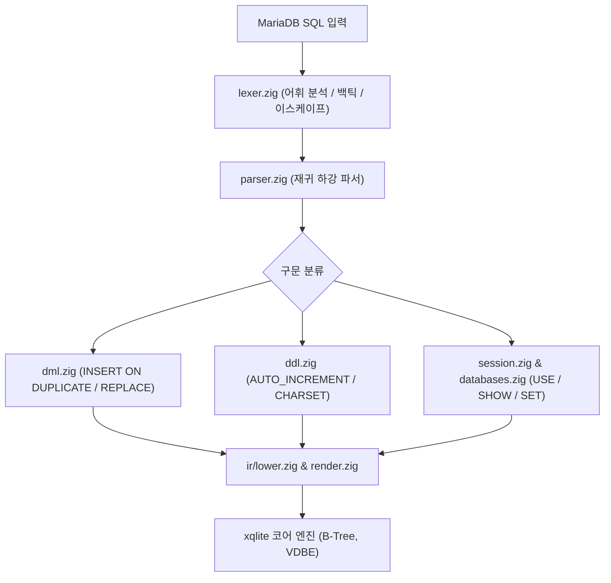

# MariaDB (MySQL) 호환: 내부 아키텍처 및 구현 세부사항

xqlite MariaDB 방언의 프론트엔드 모듈 구조, 다중 데이터베이스/스키마 매핑 메커니즘, 스토리지 구조 및 엔진 전용 함수에 대한 기술 문서입니다.

---

## 1. 프론트엔드 모듈 아키텍처

MariaDB 방언 구현체는 `src/dialect/mariadb/`에 위치하며, MySQL/MariaDB 특유의 어휘 분석 규칙과 SQL 확장을 처리합니다.



| 소스 파일 | 핵심 역할 |
| --- | --- |
| `frontend.zig` | 방언 진입점 및 세션 훅 연결 (`ConnState.mariadb`). |
| `lexer.zig` | 공통 렉서(`sqllex.Lexer`)의 MariaDB 규칙: 백틱 식별자, sql_mode에 따른 따옴표와 백슬래시 이스케이프, 실행 주석(`/*! ... */`), `@사용자변수`, 키워드 표(예약어는 `reserved` 등급). |
| `parser.zig` | SELECT 및 표현식 파싱의 핵심 루프. |
| `dml.zig` | `INSERT IGNORE`, `REPLACE INTO`, `ON DUPLICATE KEY UPDATE`의 IR 내림. |
| `ddl.zig` | MariaDB 전용 테이블 옵션, AUTO_INCREMENT, 제약조건 파싱. |
| `databases.zig` | `CREATE/DROP DATABASE`, `USE`, `SHOW DATABASES`, `db.table` 네임스페이스 해석. |
| `session.zig` | `SET sql_mode`, `SHOW WARNINGS`, `SHOW TABLES`, `DESCRIBE` 구현. |
| `infoschema.zig` | `information_schema.TABLES`, `COLUMNS`, `SCHEMATA` 가상 뷰 제공. |
| `types.zig` | MariaDB 타입 검사기, 값 변환기(`xq_coerce()`), STRICT CHECK 생성. |
| `runtime.zig` | SQLite 코어에 등록되는 MariaDB 전용 엔진 함수군(`xq_maria_*`). |

---

## 2. 다중 데이터베이스 매핑 메커니즘

MariaDB는 `CREATE DATABASE db`로 물리적 데이터베이스를 분리하고 `USE db`로 전환하지만, SQLite는 단일 파일 기반입니다. xqlite는 이를 다음과 같이 투명하게 매핑합니다.

```mermaid
flowchart TD
    subgraph MariaDB_Logical["MariaDB 논리적 관점"]
        DB1["database: main (기본 DB)"]
        DB2["database: shop"]
        T1["table: shop.users"]
    end
    subgraph SQLite_Physical["SQLite 물리적 스토리지"]
        CoreDB["SQLite main DB 파일"]
        T_Main["table: \"main_table\""]
        T_Shop["table: \"shop.users\" (접두사 네임스페이스)"]
        Seq["sqlite_sequence (shop.users 행 추적)"]
    end
    DB1 -.-> CoreDB
    DB2 -.-> CoreDB
    T1 -.-> T_Shop
    T1 -.-> Seq
```

1. **테이블 명명 규칙**:
   - `CREATE DATABASE shop;` 후 생성된 `users` 테이블은 SQLite 코어에서 `"shop.users"`라는 이름의 테이블로 물리적으로 생성됩니다.
   - 인덱스는 `"shop.users$idx_name"` 형태로 네임스페이스가 격리됩니다.
2. **시퀀스 및 카탈로그**:
   - `AUTO_INCREMENT` 카운터는 `sqlite_sequence`에 `"shop.users"` 행으로 기록되어 관리됩니다.
   - 메타데이터는 `main.xq_catalog`의 `tbl = 'shop.users'`로 보관됩니다.
3. **`USE` 명령과 세션 상태**:
   - 연결 상태(`ConnState.mariadb.current_db`)에 현재 활성 DB가 기록됩니다. 테이블 참조 시 스키마가 생략되면 현재 활성 DB 접두사가 자동으로 합성됩니다.

---

## 3. `AUTO_INCREMENT` 구현 상세

SQLite의 `AUTOINCREMENT`는 오직 `INTEGER PRIMARY KEY`에만 적용 가능하지만, MariaDB는 임의의 복합 키나 보조 인덱스의 정수 열에도 `AUTO_INCREMENT`를 지원합니다.
- xqlite는 단일 기본키 정수 열의 경우 SQLite의 최적화된 rowid 엔진을 직접 사용합니다.
- 복합 키나 비기본키인 경우, INSERT 시퀀스 트리거 및 `sqlite_sequence` 조회를 통해 엔진 수준에서 다음 ID를 자동 산출하여 대입합니다.

---

## 4. 엔진 전용 함수군 (`xq_maria_*`)

MariaDB 전용 표현식과 함수를 평가하기 위해 다음 엔진 함수들이 런타임에 등록됩니다.

- `xq_maria_json_extract(json, path)`: MariaDB 특유의 공백 및 따옴표 규칙을 준수하는 JSON 추출.
- `xq_maria_json_bool(val)`: MariaDB boolean 컨텍스트 평가.
- `xq_maria_div(a, b)`: 정수 나눗셈 `DIV` (부동소수점 오차 없는 정수 몫 반환).
- `xq_maria_like(str, pat, esc)`: 기본 이스케이프(`\`)가 적용된 대소문자 무시 LIKE.
- `xq_maria_coerce(val, target_type)`: 삽입/수정 시 `sql_mode`에 따른 유효성 검사 및 타입 캐스팅.
