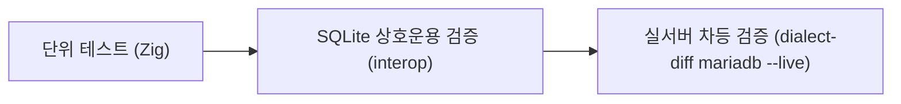

# MariaDB (MySQL) 호환: 검증 및 테스트

xqlite의 MariaDB 방언 호환성을 보증하기 위한 테스트 체계, 차등 비교(differential testing) 도구 및 실행 가이드입니다.

---

## 1. 테스트 체계 개요

MariaDB 방언은 단위 테스트와 실제 서버와의 실시간 차등 비교 테스트를 통해 검증됩니다.



1. **Zig 단위 테스트**: 렉서, 파서, 타입 강제 변환, `sql_mode` 동작을 독립적으로 검증합니다.
2. **`xqt interop mariadb`**: MariaDB 방언으로 생성된 테이블과 데이터를 표준 `sqlite3` 바이너리로 교차 로드하여 무결성을 검증합니다.
3. **`dialect-diff mariadb`**: `tools/dialect/maria-cases.txt`의 수많은 쿼리 케이스를 xqlite와 실제 MariaDB 11 인스턴스에서 동시 실행하고 결과 행, 에러 코드, 경고를 비교합니다.

---

## 2. 테스트 실행 방법

### 2.1 단위 테스트
```sh
# MariaDB 방언 단위 테스트 실행
zig build test -Dtest-filter='mariadb:'
```

### 2.2 SQLite 상호운용성 검증
```sh
zig build tools
zig-out/bin/xqt interop mariadb
```

---

## 3. 실서버 교차 검증 (`dialect-diff`)

MariaDB 서버와의 실시간 차등 검증을 수행하려면 컨테이너가 필요합니다.

```sh
# 1. MariaDB 11 컨테이너 시작
podman run -d --name xq-maria -e MARIADB_ALLOW_EMPTY_ROOT_PASSWORD=1 -p 3306:3306 mariadb:11

# 2. 컨테이너 준비 확인 (포트 준비 대기)
podman logs -f xq-maria | grep "ready for connections"

# 3. 실서버 차등 검증 실행
zig-out/bin/xqt dialect-diff mariadb --live

# 4. 특정 케이스 파일만 실행
zig-out/bin/xqt dialect-diff mariadb --live tools/dialect/maria-cases.txt
```

- 서버 접속 명령은 `$MARIA_CLIENT` 환경변수로 커스텀할 수 있습니다 (기본값: `podman exec -i xq-maria mariadb -uroot`).
- 각 테스트 케이스는 독립적인 임시 데이터베이스 환경에서 격리 실행된 후 자동으로 정리됩니다.
- 소수점이 포함된 `DECIMAL` / `REAL` 값은 표기 형식의 차이(예: `3.5000` vs `3.5`)를 정규화하여 공정하게 비교합니다.
