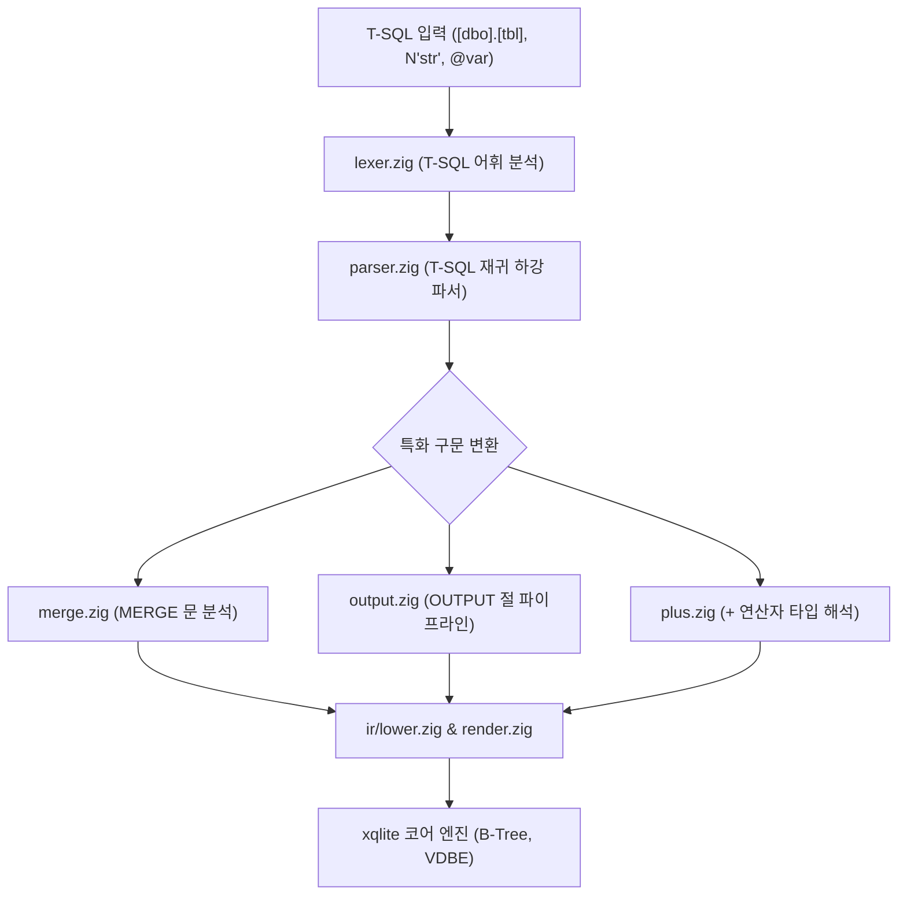

# MSSQL (T-SQL) 호환: 내부 아키텍처 및 구현 세부사항

xqlite MSSQL 방언의 프론트엔드 모듈 아키텍처, T-SQL 특화 구문(`MERGE`, `OUTPUT`)의 IR 내림 원리, 저장 강제 규칙 및 엔진 함수에 대한 기술 문서입니다.

---

## 1. 프론트엔드 모듈 아키텍처

MSSQL 방언 구현체는 `src/dialect/mssql/`에 위치하며, T-SQL 문법을 SQLite 코어의 구문 트리 IR로 변환합니다.

| 소스 파일 | 핵심 역할 |
| --- | --- |
| `frontend.zig` | T-SQL 방언 진입점 및 세션 상태 바인딩. |
| `lexer.zig` | 공통 렉서(`sqllex.Lexer`)의 T-SQL 규칙: 대괄호 식별자(`[...]`), 유니코드 리터럴(`N'...'`), 로컬 변수(`@var`), `GO` 구분자, 키워드 표(예약어는 `reserved` 등급). |
| `parser.zig` | SELECT (`TOP`, `OFFSET...FETCH`), DML, 스키마 문장 파싱. |
| `merge.zig` | `MERGE` 문을 SQLite 원자적 복합 DML 시퀀스로 변환. |
| `output.zig` | `OUTPUT INSERTED.* / DELETED.*` 절 처리를 위한 가상 임시 버퍼 연결. |
| `plus.zig` | 컴파일 시점 및 런타임 `+` 연산자 해석기 (`xq_tsql_add`). |
| `json.zig` | `OPENJSON`, `JSON_VALUE`, `JSON_MODIFY` T-SQL 전용 JSON 파서 및 가상 테이블. |
| `types.zig` | T-SQL 타입 메타데이터 기록 및 제약조건 생성. |
| `runtime.zig` | 코어 엔진 함수(`xq_tsql_*`) 등록. |

---

## 2. 특화 구문의 IR 변환 메커니즘

### 2.1 `MERGE` 문의 원자적 변환
T-SQL의 `MERGE` 문은 단일 문장 안에서 소스 테이블과 타깃 테이블을 조인하여 조건에 따라 삽입, 갱신, 삭제를 수행합니다.
- `merge.zig`는 `MERGE` 문을 파싱하여 타깃 테이블 잠금을 획득하는 단일 트랜잭션 블록으로 감쌉니다.
- `WHEN MATCHED THEN UPDATE/DELETE`는 SQLite의 조인 기반 `UPDATE/DELETE` 바이트코드로 컴파일됩니다.
- `WHEN NOT MATCHED THEN INSERT`는 매칭되지 않은 소스 행에 대한 `INSERT` 바이트코드로 컴파일됩니다.
- 전체 과정은 단일 세이브포인트 안에서 원자적으로 실행되어 도중에 오류 발생 시 전체 변경이 안전하게 롤백됩니다.

### 2.2 `OUTPUT` 절의 처리
- SQLite VDBE는 기본적으로 단일 변경 문장에서 `RETURNING`을 통해서만 결과를 반환합니다.
- T-SQL의 `OUTPUT INSERTED.id, DELETED.status`와 같이 이전 상태와 이후 상태를 동시에 요구하는 경우, 엔진 내부의 임시 VDBE 메모리 레지스터에 변경 전후 값을 캡처한 후 최종 결과 세트로 렌더링합니다.

---

## 3. `+` 연산자의 2단계 해석 파이프라인

`plus.zig`는 `+` 연산자를 다음 두 단계로 평가합니다.

1. **컴파일 시점 정적 분석**:
   - 피연산자 양쪽의 데이터 타입이 정적으로 확실한 경우(예: 둘 다 정수이거나 둘 다 문자열 리터럴):
     - 숫자 연산이면 일반 산술 `+` 바이트코드로 즉시 방출합니다.
     - 문자열 연산이면 SQLite의 문자열 결합 연산자(`||`) 바이트코드로 즉시 치환합니다.
2. **런타임 동적 폴백 (`xq_tsql_add`)**:
   - 피연산자 중 하나 이상이 동적 매개변수(`?`, `@var`)이거나 타입을 미리 알 수 없는 식인 경우:
     - 런타임 전용 엔진 함수 `xq_tsql_add(a, b)`를 호출하도록 코드를 생성합니다.
     - `xq_tsql_add`는 실행 시점에 전달된 인자의 실제 SQLite 데이터 타입을 검사하여 T-SQL 우선순위 규칙에 따라 형변환 후 연산을 수행합니다.

---

## 4. 엔진 전용 함수군 (`xq_tsql_*`)

- `xq_tsql_add(a, b)`: T-SQL 타입 우선순위에 따른 동적 덧셈/문자열 결합.
- `xq_tsql_like(str, pat)`: T-SQL 와일드카드 규칙이 적용된 패턴 매칭.
- `xq_tsql_cast(val, type)`: T-SQL 엄격 캐스팅 (변환 실패 시 에러 발생).
- `xq_tsql_try_cast(val, type)`: 안전한 캐스팅 (실패 시 NULL 반환).
- `xq_tsql_newid()`: RFC 4122 v4 UUID 생성 (36자 하이픈 문자열).
- `xq_tsql_store(val, type)`: T-SQL 열 타입 강제 저장 함수.
