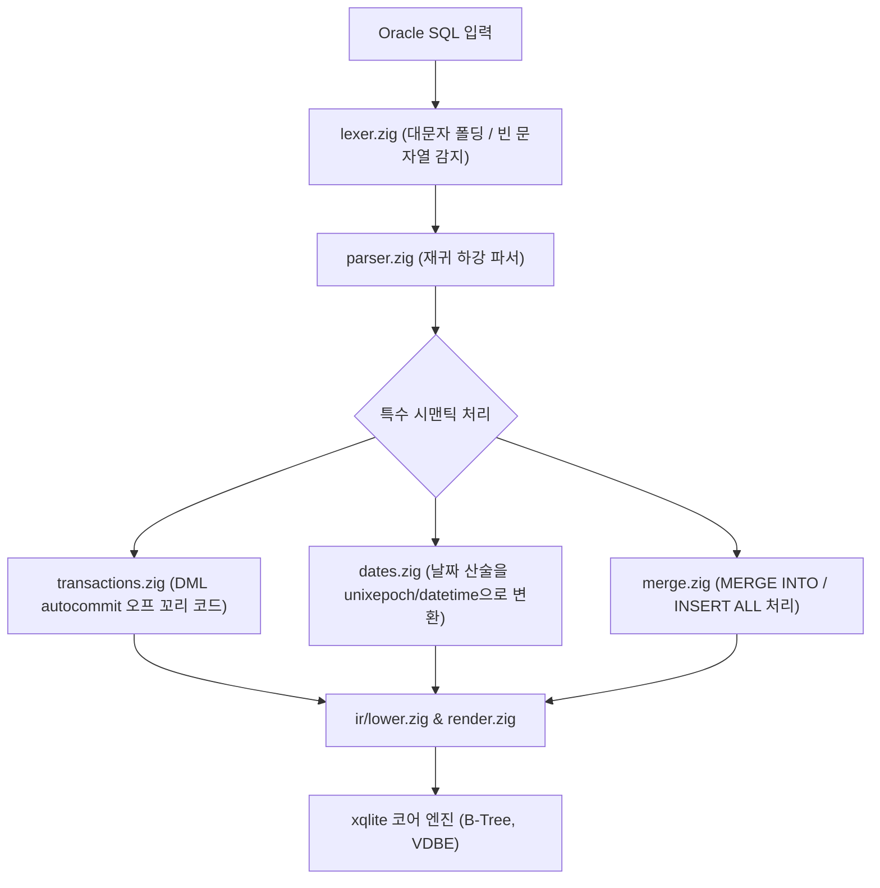

# Oracle 호환: 내부 아키텍처 및 구현 세부사항

xqlite Oracle 방언의 프론트엔드 모듈 아키텍처, 대문자 폴딩 및 빈 문자열 변환 파이프라인, 암묵적 트랜잭션의 VDBE 코드 생성 원리에 대한 기술 문서입니다.

---

## 1. 프론트엔드 모듈 아키텍처

Oracle 방언 구현체는 `src/dialect/oracle/`에 위치하며, Oracle 고유의 식별자 및 리터럴 규칙을 파싱 파이프라인 전반에 주입합니다.

| 소스 파일 | 핵심 역할 |
| --- | --- |
| `frontend.zig` | Oracle 방언 진입점 및 세션 훅 바인딩. |
| `lexer.zig` | 따옴표 없는 식별자의 대문자 변환(Upper-case folding), `''` 빈 문자열의 NULL 치환 토큰화. |
| `parser.zig` | DDL, DML, `(+)` 조인, `CONNECT BY` 계층 구문 파서. |
| `dates.zig` | `SYSDATE` 및 날짜 사칙연산(`+ n`, `- n`, `d1 - d2`)의 VDBE 식 변환기. |
| `merge.zig` | `MERGE INTO` 및 `INSERT ALL`의 복합 DML 변환. |
| `types.zig` | Oracle 논리 타입, `STRICT` CHECK 제약조건 및 ORA- 오류 코드 매핑. |
| `runtime.zig` | SQLite 코어에 등록되는 엔진 전용 함수(`xq_ora_*`). |

---

## 2. 핵심 시맨틱의 구현 원리

### 2.1 빈 문자열의 NULL 변환 메커니즘
- **토큰화 단계**: 문자열 리터럴 `''`을 감지하면 즉시 `TK_NULL` 토큰으로 방출합니다.
- **문자열 결합 (`||`)**: `plus.zig` / `render.zig`에서 피연산자 중 하나가 NULL이거나 빈 문자열인 경우 다른 쪽 피연산자를 그대로 반환하도록 단축 평가(short-circuit) 코드를 생성합니다.
- **저장 계층 강제**: 열에 값을 저장할 때 `xq_ora_coerce()`가 0바이트 텍스트를 `NULL`로 강제 치환하여 디스크에 기록합니다.

### 2.2 암묵적 트랜잭션 꼬리 코드 생성
Oracle은 문장 단위 autocommit이 아니며, 첫 DML 시 트랜잭션을 열고 열린 상태를 유지해야 합니다.
- DML(`INSERT`, `UPDATE`, `DELETE`, `MERGE`, `INSERT ALL`) 문장을 컴파일할 때, VDBE 바이트코드의 맨 끝에 `OP_AutoCommit 0` 명령어를 주입합니다.
- 이 코드는 문장 실행 직후 autocommit 플래그를 비활성화하여 트랜잭션이 자동으로 닫히지 않고 열려 있도록 보장합니다.
- 문장이 실패하는 경우에만 변경 사항을 즉시 롤백하고 트랜잭션을 열지 않도록 예외 처리기를 등록합니다.

### 2.3 날짜 산술 연산의 코어 내림
Oracle의 `DATE`는 날짜와 시간을 모두 가지며, 숫자를 더하면 일단위로 가산됩니다.
- `dates.zig`는 피연산자가 날짜 열이나 `SYSDATE`인 경우 다음 코어 함수로 변환합니다:
  - `d + n` → `datetime(d, n || ' days')`
  - `d - n` → `datetime(d, (-n) || ' days')`
  - `d1 - d2` → `(unixepoch(d1, 'subsec') - unixepoch(d2, 'subsec')) / 86400.0` (경과 일수 계산)

---

## 3. 엔진 전용 함수군 (`xq_ora_*`)

- `xq_ora_autocommit()`: 실행 시점의 autocommit 모드를 감지하여 세션 트랜잭션 상태를 동기화.
- `xq_ora_coerce(val, target_type)`: 삽입/수정 시 빈 문자열을 NULL로 변환하고 Oracle 정밀도 제약을 검사.
- `xq_ora_substr(str, pos, len)`: 1-based 및 음수 역방향 인덱스를 지원하는 Oracle 호환 `SUBSTR`.
- `xq_ora_nvl(a, b)`: NULL 대체 함수.
- `xq_ora_decode(...)`: 다중 분기 `DECODE` 평가 함수.
