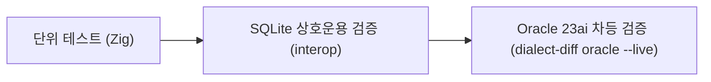

# Oracle 호환: 검증 및 테스트

xqlite의 Oracle 방언 호환성을 보증하기 위한 테스트 체계, 차등 비교(differential testing) 도구 및 실행 가이드입니다.

---

## 1. 테스트 체계 개요

Oracle 방언은 단위 테스트, SQLite 상호운용성 검증, Oracle Database 23ai 컨테이너와의 실시간 차등 비교를 통해 검증됩니다.



1. **Zig 단위 테스트**: 대문자 폴딩, 빈 문자열=NULL 처리, 날짜 함수, MERGE 구문, 트랜잭션 꼬리 코드 생성을 검증합니다.
2. **`xqt interop oracle`**: Oracle 방언으로 생성된 테이블과 데이터를 표준 `sqlite3` 바이너리로 교차 로드하여 무결성을 검증합니다.
3. **`dialect-diff oracle`**: `tools/dialect/oracle-cases.txt`의 테스트 케이스를 xqlite와 실제 Oracle Database 23ai에서 동시 실행하고 결과를 문자 단위로 비교합니다.

---

## 2. 테스트 실행 방법

### 2.1 단위 테스트
```sh
# Oracle 방언 단위 테스트 실행
zig build test -Dtest-filter='oracle:'
```

### 2.2 SQLite 상호운용성 검증
```sh
zig build tools
zig-out/bin/xqt interop oracle
```

---

## 3. 실서버 교차 검증 (`dialect-diff`)

실제 Oracle Database와의 비교 검증을 수행하려면 컨테이너가 필요합니다.

```sh
# 1. Oracle Database 23ai Free 컨테이너 시작
podman run -d --name xq-oracle -p 1521:1521 \
  -e ORACLE_PASSWORD=Xq_Passw0rd! \
  container-registry.oracle.com/database/free:latest

# 2. 실서버 차등 검증 실행
zig-out/bin/xqt dialect-diff oracle --live

# 3. 특정 케이스 파일만 지정 실행
zig-out/bin/xqt dialect-diff oracle --live tools/dialect/oracle-cases.txt
```

- SQL*Plus의 특유의 헤더 포맷, 열 너비 잘림, 소수점 앞 `0` 표기 차이(예: `.5` vs `0.5`)는 테스트 러너에서 자동으로 정규화되어 논리적 동등성을 검증합니다.
