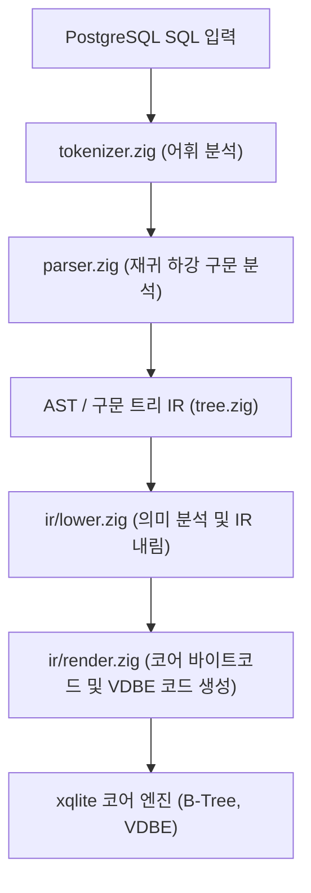

# PostgreSQL 호환: 내부 아키텍처 및 구현 세부사항

xqlite PostgreSQL 방언의 프론트엔드 파이프라인, 바이트코드/IR 변환 메커니즘, 스토리지 인코딩 및 엔진 확장 함수에 대한 기술 문서입니다.

---

## 1. 프론트엔드 모듈 아키텍처

PostgreSQL 방언 구현체는 `src/dialect/postgres/`에 위치하며, 독립적인 파서와 공용 IR 변환기를 통해 SQLite 코어로 컴파일됩니다.

| 소스 파일 | 핵심 역할 |
| --- | --- |
| `frontend.zig` | 방언 진입점. 질의 문자열을 받아 어휘/구문 분석을 구동하고 IR 생성을 조율합니다. |
| `tokenizer.zig` | PostgreSQL 어휘 규칙을 따르는 렉서. `$1` 매개변수, `$$` 달러 인용 문자열, 식별자 소문자 폴딩을 처리합니다. |
| `parser.zig` | SELECT, DML, DDL 전체를 아우르는 고성능 파서. 식과 연산자 우선순위를 PostgreSQL 규칙에 맞게 처리합니다. |
| `types.zig` | PostgreSQL 논리 타입 정의, 코어 스토리지 타입 매핑 및 OID 테이블 관리. |
| `overload.zig` | 연산자 및 함수 오버로딩 해결기. 인자 타입에 따른 최적 엔진 함수 매핑. |
| `pgcatalog.zig` | `pg_catalog` 및 `information_schema` 가상 테이블 구현. |
| `uuid.zig` | RFC 9562 UUID v4/v7 생성 및 16바이트 BLOB 직렬화 함수군. |
| `json.zig` | JSONB 바이너리 포맷 파싱 및 질의 최적화 루틴. |
| `arrays.zig` | 다차원 배열 텍스트 직렬화 및 슬라이스/원소 접근자 처리. |

---

## 2. 스토리지 인코딩 및 직렬화 포맷

### 2.1 UUID 인코딩
- **저장 포맷**: 16바이트 바이너리 `BLOB` (네트워크 바이트 순서 / big-endian).
- **정렬 일관성**: RFC 9562 표준 바이트 순서와 SQLite의 `memcmp` 동작이 일치하므로 인덱스 정렬 시 추가 변환 비용이 없습니다.
- **UUIDv7 구조**:
  - 상위 48비트: Unix 타임스탬프 (밀리초)
  - 중간 12비트: 밀리초 내 단조 증가 시퀀스 카운터
  - 하위 68비트: 난수 엔트로피

### 2.2 JSONB 인코딩
- **바이너리 저장**: 공백이 제거되고 객체의 키가 사전순으로 정렬된 정규화된 표현으로 저장됩니다.
- **검색 최적화**: 경로 탐색 연산자(`#>`, `->`)는 전체 문서를 재파싱하지 않고 내부 토큰 오프셋을 직접 스킵하여 수행됩니다.

### 2.3 배열 (Arrays)
- **텍스트 정규화**: PostgreSQL의 표준 배열 출력 형식(예: `{1,2,3}`, `{"hello world","foo"}`)으로 정규화되어 `TEXT`로 저장됩니다.
- **다차원 배열**: `{{1,2},{3,4}}` 형태의 중첩 브레이스 구조를 유지하며, 인덱스 접근(`a[1][2]`) 시 필요한 부분만 파싱하여 읽어 들입니다.

---

## 3. 타입 저장 변환 규칙 (`Rules.store`)

테이블 열에 값을 저장할 때 방언 규칙에 따라 타입 강제가 적용됩니다.

1. **정수 열 (`smallint`, `int`, `bigint`)**:
   - 문자열 입력 시 공백을 허용하며 엄격한 범위 검사를 거칩니다. 부동소수점 숫자가 들어올 경우 0에서 먼 쪽으로 반올림(Round away from zero)하여 저장합니다.
2. **부동소수점 및 Numeric 열**:
   - 부동소수점 값은 IEEE 754 형식으로 변환되며, 비정상적 값(NaN, Infinity)은 PostgreSQL 에러 코드로 차단됩니다.
3. **불리언 열**:
   - `'t'`, `'true'`, `'1'`, `1`은 정수 `1`로, `'f'`, `'false'`, `'0'`, `0`은 정수 `0`으로 치환 저장됩니다.

---

## 4. OID 및 카탈로그 시스템 매핑

PostgreSQL 와이어 프로토콜 서버 및 드라이버 연동을 위해 내부 논리 타입과 표준 OID(Object Identifier)가 1:1로 매핑됩니다.

| 논리 타입 | OID | 배열 OID | 설명 |
| --- | --- | --- | --- |
| `bool` | 16 | 1000 | 불리언 |
| `bytea` | 17 | 1001 | 바이너리 데이터 |
| `name` | 19 | 1003 | 시스템 식별자 |
| `int8` | 20 | 1016 | 64비트 정수 |
| `int2` | 21 | 1005 | 16비트 정수 |
| `int4` | 23 | 1007 | 32비트 정수 |
| `text` | 25 | 1009 | 가변 길이 문자열 |
| `oid` | 26 | 1028 | 객체 식별자 |
| `json` | 114 | 199 | 텍스트 기반 JSON |
| `float4` | 700 | 1021 | 단정밀도 실수 |
| `float8` | 701 | 1022 | 배정밀도 실수 |
| `varchar` | 1043 | 1015 | 가변 길이 문자열 |
| `date` | 1082 | 1182 | 날짜 |
| `timestamp` | 1114 | 1115 | 타임스탬프 |
| `timestamptz` | 1184 | 1185 | 시간대 포함 타임스탬프 |
| `interval` | 1186 | 1187 | 시간 간격 |
| `numeric` | 1700 | 1231 | 임의 정밀도 숫자 |
| `uuid` | 2950 | 2951 | 128비트 UUID |
| `jsonb` | 3802 | 3807 | 바이너리 JSON |

---

## 5. 엔진 전용 함수군 (`xq_pg_*`)

코어 SQLite VDBE에서 PostgreSQL 고유 연산 및 의미론을 수행하기 위해 방언 런타임 함수들이 등록됩니다.

- `xq_pg_any(val, arr, op)`: ANY / ALL 배열 원소 조건 검사.
- `xq_pg_array_valid(text)`: 배열 리터럴 구문 유효성 검사.
- `xq_pg_uuid(text)`: 텍스트를 16바이트 UUID BLOB으로 변환.
- `xq_pg_uuid_text(blob)`: 16바이트 UUID BLOB을 표준 36자 텍스트로 역변환.
- `xq_pg_interval_add(...)`: timestamptz와 interval 간의 복합 덧셈 연산.
