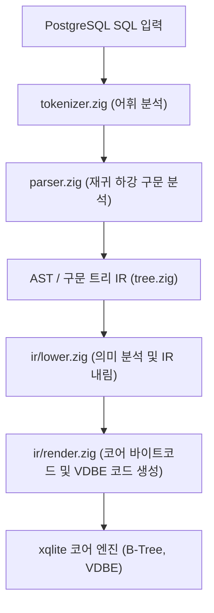
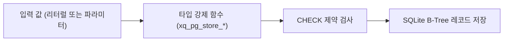

# PostgreSQL 호환: 내부 아키텍처 및 구현 세부사항

xqlite PostgreSQL 방언의 프론트엔드 파이프라인, 바이트코드/IR 변환 메커니즘, 스토리지 인코딩 및 엔진 확장 함수에 대한 기술 문서입니다.

---

## 1. 프론트엔드 모듈 아키텍처

PostgreSQL 방언 구현체는 `src/dialect/postgres/`에 위치하며, 독립적인 파서와 공용 IR 변환기를 통해 SQLite 코어로 컴파일됩니다.

| 소스 파일 | 핵심 역할 |
| --- | --- |
| `frontend.zig` | 방언 진입점. 질의 문자열을 받아 어휘/구문 분석을 구동하고 IR 생성을 조율합니다. |
| `lexer.zig` | 공통 렉서(`sqllex.Lexer`)의 PostgreSQL 규칙(`$1` 매개변수, `$$` 달러 인용, `U&'..'`와 UESCAPE, 연산자 규칙)과 키워드 표, `E'..'`·`U&` 이스케이프를 푸는 `Decoder`. 문장을 미리 토큰화하며 렉서 오류를 냅니다(`statement()`). |
| `parser.zig` | SELECT, DML, DDL 전체를 아우르는 고성능 파서. 식과 연산자 우선순위를 PostgreSQL 규칙에 맞게 처리합니다. |
| `types.zig` | PostgreSQL 논리 타입 정의, 코어 스토리지 타입 매핑 및 OID 테이블 관리. |
| `overload.zig` | 연산자 및 함수 오버로딩 해결기. 인자 타입에 따른 최적 엔진 함수 매핑. |
| `pgcatalog.zig` | `pg_catalog` 및 `information_schema` 가상 테이블 구현. |
| `uuid.zig` | RFC 9562 UUID v4/v7 생성 및 16바이트 BLOB 직렬화 함수군. |
| `json.zig` | JSONB 바이너리 포맷 파싱 및 질의 최적화 루틴. |
| `arrays.zig` | 다차원 배열 텍스트 직렬화 및 슬라이스/원소 접근자 처리. |
| `ddl.zig`, `alter.zig` | DDL의 PostgreSQL 검사와 오류. `alter.zig`는 SQLite에 없는 ALTER TABLE: 여러 동작(동작마다 한 문장으로 차례로 실행, `catalog.codeExecDialect()`), `ALTER COLUMN`, `ADD`/`DROP CONSTRAINT`(`sqlite_schema`의 CREATE TABLE 텍스트를 `ir/coldef.zig`로 고치고 스키마를 다시 읽음, 행 검사는 그 앞, 새 타입의 값 쓰기는 그 뒤), 상수가 아닌 DEFAULT의 `ADD COLUMN`. |
| `enums.zig` | 열거형: `xq_catalog`의 행(`tbl ''`, `col` 타입 이름, `key 'enum'`, 값은 레이블의 JSON 배열), 열마다의 CHECK, 캐스트 `xq_pg_enum_in()`, `CREATE`/`ALTER`/`DROP TYPE`. |
| `mathfuncs.zig` | 배정밀도의 삼각·쌍곡·특수 함수(`sind`, `erf`, `gamma` ...)와 그 오류, `round(x)`(짝수 쪽 반올림), PostgreSQL의 PRNG(xoroshiro128**, 세션의 `State.prng`)를 쓰는 `random()`·`random(min, max)`·`random_normal()`·`setseed()`. `exp`·`log`·`pow` 계열과 `erf`·`erfc`는 musl을 옮긴 `../libm.zig`. |
| `ordered.zig` | 분수 배열의 `percentile_cont(float8[])`·`percentile_disc(float8[])`(`xq_pg_percentile_*_arr`). 통계·순서 집합·가상 집합 집계 자체는 방언 밖의 `../stats.zig`(실수)와 `../decimal_sql.zig`(numeric의 분산)에 있고, 파서가 `WITHIN GROUP`을 집계의 `ORDER BY`로 내립니다. |
| `commands.zig` | `PREPARE`/`EXECUTE`/`DEALLOCATE`(세션의 문장 텍스트, `EXECUTE`는 인자를 넣어 `frontend.compile()`로 다시 컴파일하고 와이어 서버의 태그를 위해 `Vdbe.xq_command_sql`을 둠), `DISCARD`, `SET CONSTRAINTS`(`PRAGMA defer_foreign_keys`), `LOCK TABLE`(검사만). |
| `cursor.zig` | 커서: `DECLARE`(실행할 때 질의를 돌려 행을 세션의 메모리에 둠, `xq_pg_cursor_declare()`), `FETCH`(커서의 열을 `json_each(xq_pg_cursor_fetch(...))`의 행 번호 위에서 `xq_pg_cursor_value()`로 읽는 질의, 열마다 질의가 준 타입: `tree.Func.result_type_id`), `MOVE`(`changes()`가 지나간 행 수), `CLOSE`, `WHERE CURRENT OF`(`rowid = xq_pg_cursor_rowid(...)`), `pg_cursors`(`xq_pg_cursors()`). 트랜잭션과 세이브포인트의 끝은 코어가 `dialect.transactionEnded()`·`savepointEnded()`로 알립니다. |
| `inet.zig` | `inet`·`cidr`의 입력과 PostgreSQL의 출력 텍스트, `xq_pg_inet()`·`xq_pg_cidr()`, `host()`·`masklen()`·`family()`. |
| `dml.zig` | `MERGE`와 데이터 변경 `WITH`: 문장이 돌 때 실행할 단계(문장들)와, 단계가 남긴 행을 읽는 바깥 질의를 만듭니다([6장](#6-merge와-데이터-변경-with)). |
| `rows.zig` | 단계의 실행(`Hooks.run_steps`, `OP_SqlExec`의 `0x0008`)과 단계가 남긴 행의 슬롯, 그것을 읽는 테이블 값 함수 `"xq_pg_rows_<hash>:<spec>"(slot)`. |

---

## 2. 스토리지 인코딩 및 직렬화 포맷

### 2.1 UUID 인코딩
- **저장 포맷**: 16바이트 바이너리 `BLOB` (네트워크 바이트 순서 / big-endian).
- **정렬 일관성**: RFC 9562 표준 바이트 순서와 SQLite의 `memcmp` 동작이 일치하므로 인덱스 정렬 시 추가 변환 비용이 없습니다.
- **UUIDv7 구조**:
  - 상위 48비트: Unix 타임스탬프 (밀리초)
  - 중간 12비트: 밀리초 내 단조 증가 시퀀스 카운터
  - 하위 68비트: 난수 엔트로피

### 2.2 JSONB 인코딩
- **바이너리 저장**: 공백이 제거되고 객체의 키가 사전순으로 정렬된 정규화된 표현으로 저장됩니다.
- **검색 최적화**: 경로 탐색 연산자(`#>`, `->`)는 전체 문서를 재파싱하지 않고 내부 토큰 오프셋을 직접 스킵하여 수행됩니다.

### 2.3 배열 (Arrays)
- **텍스트 정규화**: PostgreSQL의 표준 배열 출력 형식(예: `{1,2,3}`, `{"hello world","foo"}`)으로 정규화되어 `TEXT`로 저장됩니다.
- **다차원 배열**: `{{1,2},{3,4}}` 형태의 중첩 브레이스 구조를 유지하며, 인덱스 접근(`a[1][2]`) 시 필요한 부분만 파싱하여 읽어 들입니다.

---

## 3. 타입 저장 변환 규칙 (`Rules.store`)

테이블 열에 값을 저장할 때 방언 규칙에 따라 타입 강제가 적용됩니다.

1. **정수 열 (`smallint`, `int`, `bigint`)**:
   - 문자열 입력 시 공백을 허용하며 엄격한 범위 검사를 거칩니다. 부동소수점 숫자가 들어올 경우 0에서 먼 쪽으로 반올림(Round away from zero)하여 저장합니다.
2. **부동소수점 및 Numeric 열**:
   - 부동소수점 값은 IEEE 754 형식으로 변환되며, 비정상적 값(NaN, Infinity)은 PostgreSQL 에러 코드로 차단됩니다.
3. **불리언 열**:
   - `'t'`, `'true'`, `'1'`, `1`은 정수 `1`로, `'f'`, `'false'`, `'0'`, `0`은 정수 `0`으로 치환 저장됩니다.
4. **`inet`·`cidr` 열**:
   - 문자열과 매개변수는 `xq_pg_inet()`·`xq_pg_cidr()`를 거쳐 PostgreSQL의 출력 텍스트로 저장됩니다(`'2001:0db8::1'`은 `2001:db8::1`). 잘못된 값은 오류입니다.
5. **열거형 열**:
   - 레이블의 텍스트로 저장되고, 열의 CHECK(`invalid input value for enum T`)가 레이블 밖의 값을 막습니다. `ALTER TYPE ... ADD VALUE`/`RENAME VALUE`는 그 타입의 열이 있는 테이블마다 CHECK를 다시 씁니다.

문자열 상수의 `DEFAULT`는 테이블을 만들 때 열 타입의 캐스트로 계산해 상수로 둡니다(`parser.zig`의 `foldDefault()`: `bool DEFAULT 'f'`는 `DEFAULT (0)`). SQLite의 ADD COLUMN은 상수 DEFAULT만 받기 때문이기도 합니다.

---

## 4. OID 및 카탈로그 시스템 매핑

PostgreSQL 와이어 프로토콜 서버 및 드라이버 연동을 위해 내부 논리 타입과 표준 OID(Object Identifier)가 1:1로 매핑됩니다.

| 논리 타입 | OID | 배열 OID | 설명 |
| --- | --- | --- | --- |
| `bool` | 16 | 1000 | 불리언 |
| `bytea` | 17 | 1001 | 바이너리 데이터 |
| `name` | 19 | 1003 | 시스템 식별자 |
| `int8` | 20 | 1016 | 64비트 정수 |
| `int2` | 21 | 1005 | 16비트 정수 |
| `int4` | 23 | 1007 | 32비트 정수 |
| `text` | 25 | 1009 | 가변 길이 문자열 |
| `oid` | 26 | 1028 | 객체 식별자 |
| `json` | 114 | 199 | 텍스트 기반 JSON |
| `float4` | 700 | 1021 | 단정밀도 실수 |
| `float8` | 701 | 1022 | 배정밀도 실수 |
| `varchar` | 1043 | 1015 | 가변 길이 문자열 |
| `date` | 1082 | 1182 | 날짜 |
| `timestamp` | 1114 | 1115 | 타임스탬프 |
| `timestamptz` | 1184 | 1185 | 시간대 포함 타임스탬프 |
| `interval` | 1186 | 1187 | 시간 간격 |
| `numeric` | 1700 | 1231 | 임의 정밀도 숫자 |
| `uuid` | 2950 | 2951 | 128비트 UUID |
| `jsonb` | 3802 | 3807 | 바이너리 JSON |

---

## 5. 엔진 전용 함수군 (`xq_pg_*`)

코어 SQLite VDBE에서 PostgreSQL 고유 연산 및 의미론을 수행하기 위해 방언 런타임 함수들이 등록됩니다.

- `xq_pg_any(val, arr, op)`: ANY / ALL 배열 원소 조건 검사.
- `xq_pg_array_valid(text)`: 배열 리터럴 구문 유효성 검사.
- `xq_pg_uuid(text)`: 텍스트를 16바이트 UUID BLOB으로 변환.
- `xq_pg_uuid_text(blob)`: 16바이트 UUID BLOB을 표준 36자 텍스트로 역변환.
- `xq_pg_interval_add(...)`: timestamptz와 interval 간의 복합 덧셈 연산.

---

## 6. MERGE와 데이터 변경 WITH

SQLite에 없는 두 문장은 문장이 돌 때 차례로 실행하는 **단계**와, 단계가 남긴 행을 읽는 **바깥 질의**로 만듭니다(`dml.zig`).

- 단계는 `OP_SqlExec`(p1 `0x0008`) 하나에 담깁니다. 단계의 문장은 그때 연결의 방언으로 컴파일하고, 바깥 문장의 매개변수(`$1` ...)를 같은 번호로 받습니다(`rows.runSteps()`). 세이브포인트 없이 바깥 문장의 문장 트랜잭션 안에서 돌므로(바깥 문장은 대상 테이블의 데이터베이스에 쓰는 문장으로 컴파일됨), 어느 단계나 바깥 질의가 실패하면 문장 전체가 되돌아갑니다.
- 단계가 돌려준 행은 연결의 **슬롯**(`State.dml_rows`)에 남습니다. 슬롯 번호는 문장을 컴파일할 때 정하고, 문장이 다시 돌면 비우고, 바깥 질의 뒤에 풉니다. 바깥 질의는 그 행을 테이블 값 함수 `"xq_pg_rows_<hash>:<spec>"(slot)`로 읽습니다. 이름의 spec이 열의 이름과 타입(PostgreSQL 철자와 `Type`)이라 열은 원래 열·식의 타입이고(`Hooks.table_function_type`), 숨은 열 `xq_key`(조인의 몇 번째 행에서 왔는지), `xq_tag`(조인 행이 고른 `WHEN` 절, 바뀐 행의 동작), `xq_action`(`merge_action()`), `xq_target`(대상 행의 rowid)을 가집니다. rowid는 슬롯 안의 순서이고, `rowid = ?`는 그 행만 읽습니다.

`MERGE INTO t USING s ON cond WHEN ...`의 단계는 다음과 같습니다.

1. 조인: `SELECT t.rowid, CASE ... END, s.* FROM t {FULL|RIGHT|} JOIN (SELECT *, true AS xq_m FROM s) AS s ON cond`. `CASE`는 짝(일치, 원본만, 대상만)마다 조건이 맞는 첫 `WHEN` 절의 번호입니다. 원본의 열과 타입은 컴파일할 때 `SELECT * FROM s`를 따로 해석해 압니다.
2. 같은 대상 행을 바꾸는(`DO NOTHING`이 아닌) 조인 행이 둘이면 21000.
3. `WHEN` 절마다 그 절을 고른 조인 행에: `UPDATE t SET ... FROM rows AS s WHERE s.xq_tag = k AND t.rowid = s.xq_target`, `DELETE FROM t WHERE rowid IN (...)`, `INSERT INTO t (cols) SELECT values FROM rows AS s WHERE s.xq_tag = k ORDER BY s.rowid`(값의 `DEFAULT`는 그 열을 빼고, `DEFAULT VALUES`는 행마다 한 번). 바뀐 행 수가 문장의 `changes()`입니다.
4. `RETURNING`이 있으면 각 동작이 바꾼 행의 대상 열(그리고 `old.*`, `new.*`)을 남기고, 조인 순서로 정렬합니다. 바깥 질의는 `SELECT <RETURNING> FROM rows(대상) AS t LEFT JOIN rows(조인) AS s ON s.rowid = t.xq_key`입니다.

데이터 변경 `WITH`의 문장은 앞의 `WITH` 질의(데이터 변경 문장은 그 결과를 읽는 질의로)를 붙여 차례로 돌고, `RETURNING` 대신 대상의 모든 열과 `old.*`, `new.*`를 남깁니다. 그 CTE의 질의는 남긴 행 위의 `RETURNING` 목록입니다.

`RETURNING`의 `old.a`·`new.a`는 파서가 이름 `"\x00old"`·`"\x00new"`(SQL 텍스트에는 쓸 수 없는 이름)로 바꾸고, 코어의 `RETURNING` 해석(`resolve.zig`)이 그 이름을 바꾸기 전·뒤 행의 레지스터로 읽습니다(없는 쪽은 NULL). 단계가 남긴 행에서는 숨은 열 `"old.a"`·`"new.a"`입니다.
