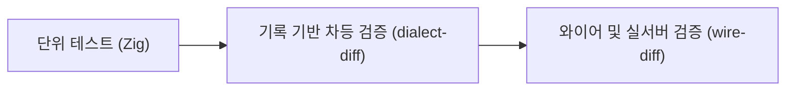

# PostgreSQL 호환: 검증 및 테스트

xqlite의 PostgreSQL 방언 호환성을 보증하기 위한 테스트 체계, 차등 비교(differential testing) 도구 및 실행 가이드입니다.

---

## 1. 테스트 체계 개요

PostgreSQL 방언은 세 단계의 검증 파이프라인을 통해 네이티브 PostgreSQL 18과 동일한 동작을 유지합니다.



1. **Zig 단위 테스트**: 파서, 렉서, 타입 변환기, 직렬화 인코더를 개별 검증합니다.
2. **`dialect-diff pg`**: 수백 개의 SQL 질의를 xqlite와 PostgreSQL 18 기준 기대 결과(`tools/dialect/pg-expected/*.out`)와 문자 단위로 비교합니다. (로컬 DB 서버 불필요)
3. **`wire-diff pg`**: PostgreSQL 와이어 프로토콜 서버에 실제 `psql` 클라이언트로 접속하여 세션 및 질의 결과를 실시간 교차 검증합니다.

---

## 2. 테스트 실행 방법

### 2.1 빠른 단위 테스트
PostgreSQL 방언 관련 단위 테스트만 빠르게 실행합니다.

```sh
# PostgreSQL 방언 단위 테스트 실행
zig build test -Dtest-filter='pg:'

# 특정 기능군 테스트 (예: 배열 관련)
zig build test -Dtest-filter='pg: arrays'
```

### 2.2 방언 차등 테스트 (`dialect-diff pg`)
저장된 PostgreSQL 18 기대 출력과 오프라인으로 고속 비교합니다. (수 초 이내 완료)

```sh
# 도구 빌드 및 전체 케이스 비교
zig build tools
zig-out/bin/xqt dialect-diff pg

# 특정 케이스 파일만 지정 실행
zig-out/bin/xqt dialect-diff pg tools/dialect/pg-array-cases.txt
```

### 2.3 SQLite 상호운용성 검증 (`interop`)
PostgreSQL 방언으로 작성된 데이터베이스 파일을 표준 `sqlite3` 바이너리에서 무결성 검사(`PRAGMA integrity_check`)하고 읽어들일 수 있는지 검증합니다.

```sh
zig-out/bin/xqt interop pg
```

---

## 3. 실서버 교차 검증 및 기록 갱신

새로운 SQL 구문을 추가하거나 PostgreSQL 18 실제 인스턴스와 직접 비교해야 하는 경우 Podman/Docker 컨테이너를 사용합니다.

```sh
# 1. PostgreSQL 18 컨테이너 실행
podman run -d --name xq-pg -e POSTGRES_HOST_AUTH_METHOD=trust -p 5432:5432 postgres:18-alpine

# 2. 실서버 비교 모드로 실행
zig-out/bin/xqt dialect-diff pg --live

# 3. 새로운 케이스 추가 후 기대값 기록 생성/갱신
zig-out/bin/xqt dialect-diff pg --record tools/dialect/pg-new-cases.txt

# 4. 와이어 프로토콜 회귀 테스트 실행
zig-out/bin/xqt wire-diff pg --regress
```

---

## 4. 검증 현황 요약

- **SQL 질의 일치율**: `pg-cases.txt`, `pg-jsonb-cases.txt`, `pg-array-cases.txt` 등 핵심 테스트 세트 100% 통과.
- **카탈로그 호환**: `psql` 16/18 클라이언트의 메타 명령(`\d`, `\dt`, `\di`, `\df`, `\dn` 등) 지원 완료.
- **SQLite 확장을 통한 호환**: `libxqlite_ext`를 로드한 순수 `sqlite3`에서도 PostgreSQL 방언 테이블을 온전히 조회 및 갱신 가능.
