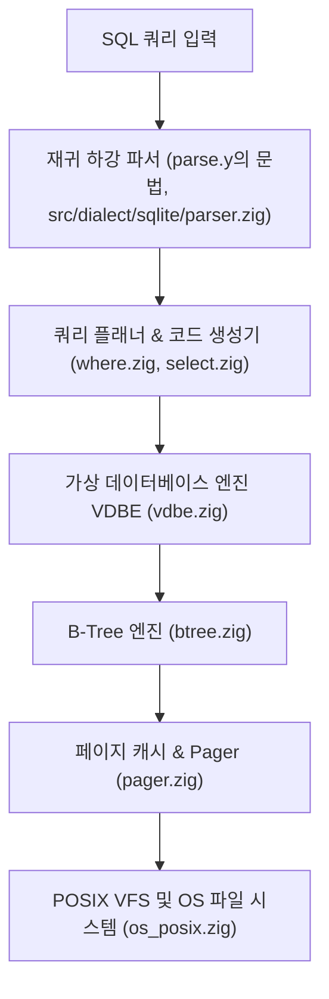
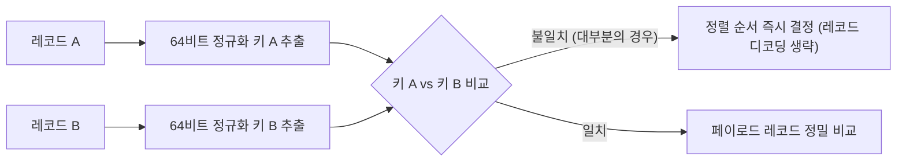

# SQLite 호환: 내부 아키텍처 및 구현 세부사항

xqlite의 순수 Zig(0.17) SQLite 3.54.1 포팅 구조, 바이트코드 가상 머신(VDBE), 정렬기 최적화 및 스토리지 레이어에 대한 기술 문서입니다.

---

## 1. 아키텍처 레이어 구조

xqlite의 코어 엔진은 SQLite의 전통적인 계층형 아키텍처를 순수 Zig 코드로 완전히 재구현하였습니다.

| 모듈 경로 | 핵심 역할 |
| --- | --- |
| `src/dialect/sqlite/` | SQLite의 렉서와 재귀 하강 파서. `parse.y`의 문법을 손으로 옮긴 것으로, 같은 빌더를 같은 순서로 불러 SQLite와 같은 바이트코드를 만듭니다. |
| `src/sql/` | 코드 생성기(SQLite C 포팅). |
| `src/vdbe/` | 바이트코드 인터프리터(VDBE), Opcode 디스패치 루프, 레지스터 및 커서 관리. |
| `src/btree/` | B-Tree 페이지 분할/병합, 셀 인코딩, 테이블/인덱스 B-Tree 순회. |
| `src/pager/` | 페이지 캐시(PCache), 롤백 저널, WAL 로깅, 체크포인트 관리. |
| `src/vfs/` | POSIX 파일 잠금(Fcntl), 원자적 동기화(`fsync`), 디스크 I/O 추상화. |

---

## 2. 정렬기(Sorter)의 64비트 정규화 키 최적화

xqlite의 정렬기(`ORDER BY`, `GROUP BY`, `CREATE INDEX`)는 SQLite의 외부 병합 정렬(`vdbesort.c`) 아키텍처를 기반으로 하되, Turso의 최적화 기법에서 영감을 얻은 **64비트 정규화 정렬 키(Normalized Key)** 비교 기법이 적용되어 있습니다.

1. **동작 원리**:
   - 메모리 내 정렬 및 임시 PMA(Pending Merge Accumulator) 병합 시, 첫 번째 정렬 열로부터 정렬 순서를 보존하는 64비트 정수 키를 미리 계산합니다.
   - 키가 서로 다르면 전체 레코드(바이트 스트림)를 디코딩하지 않고 64비트 정수 비교 한 번으로 대소 관계를 즉시 결정합니다.
2. **단축 평가 (Short-circuiting)**:
   - 7바이트 이하의 짧은 텍스트/블롭, 소형 정수 등 64비트 키 안에 값 전체가 온전히 담기는 경우, 키가 같으면 첫 번째 열의 값도 완전히 같으므로 레코드 비교 단계에서도 첫 번째 열의 역직렬화를 건너뜁니다.
3. **완벽한 호환성**:
   - 이 최적화는 내부 비교 루프에만 국한되며, 생성되는 바이트코드(`EXPLAIN`), 임시 파일 구조 및 최종 정렬 순서는 SQLite 3.54.1과 완전히 일치합니다.

---

## 3. 메모리 안전성 및 리소스 관리

- Zig 언어의 명시적 할당자(Explicit Allocator) 패턴을 엄격히 적용하여 메모리 누수를 원천 차단합니다.
- 대규모 sqllogictest 및 장시간 퍼징(`fuzzcheck`)을 통해 OOM 상황에서도 리소스 누수 없이 안전하게 롤백되는 것을 지속적으로 검증합니다.
