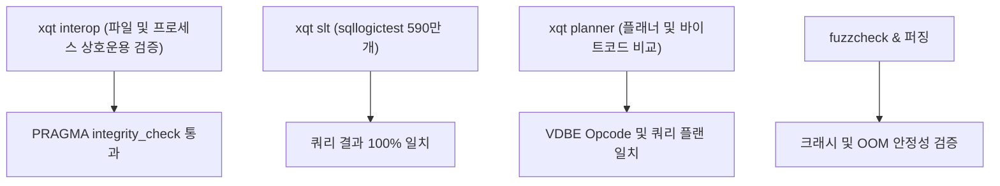

# SQLite 호환: 검증 및 테스트

xqlite의 SQLite 3.54.1 호환성을 보증하기 위한 광범위한 테스트 스위트, 상호운용성 검증 도구 및 실행 가이드입니다.

---

## 1. 테스트 체계 개요

xqlite는 SQLite 공식 테스트 도구 및 독자 검증 러너(`xqt`)를 결합하여 엄격한 품질을 보증합니다.



| 도구 | 대상 영역 | 보장 내용 |
| --- | --- | --- |
| **`xqt interop btree, sql`** | 파일 및 B-Tree | 두 엔진이 상호 수정한 DB 파일의 무결성(`PRAGMA integrity_check`) 검증. |
| **`xqt interop wal, hot-journal`**| 저널링 & 복구 | 크래시 상황 시 핫 저널 상호 복구, 동시 프로세스 읽기/쓰기 검증. |
| **`xqt interop vacuum, attach`** | 다중 DB & 백업 | `VACUUM INTO` 바이트 단위 일치, 슈퍼 저널 롤백 복구 검증. |
| **`xqt planner`** | 쿼리 플래너 & VDBE | 복잡한 조인 질의의 `EXPLAIN QUERY PLAN` 및 바이트코드 일치 검증. |
| **`xqt slt`** | sqllogictest | 스크립트 622개, 테스트 5,939,879개 전체 통과 (롤백 저널 및 WAL 모드). |
| **`xqlite fuzzcheck`** | 퍼징 코퍼스 | 공식 SQLite 퍼즈 코퍼스(`test/fuzzdata*.db`) 상 무결함 검증. |
| **`xqt tcl`** | SQLite의 TCL 테스트 | `test/*.test` 1186개를 같은 테스트 픽스처로 libxqlite3와 SQLite 3.54.1에서 돌려 테스트마다 분류(두 쪽 통과·두 쪽 실패·xqlite만 실패). 기준선은 [테스트와 검증](../testing.md#기준선). |

---

## 2. 테스트 실행 방법

### 2.1 상호운용성 검증 (`interop`)
```sh
zig build tools

# B-Tree 및 SQL 기본 상호운용성 검사
zig-out/bin/xqt interop btree
zig-out/bin/xqt interop sql

# WAL 모드 및 핫 저널 복구 검사
zig-out/bin/xqt interop wal
zig-out/bin/xqt interop hot-journal

# 전 항목 일괄 검사
zig-out/bin/xqt interop
```

### 2.2 플래너 및 바이트코드 비교 (`planner`)
```sh
zig-out/bin/xqt planner
```

### 2.3 sqllogictest 실행 (`slt`)
```sh
# 기본 스크립트 실행
zig-out/bin/xqt slt

# WAL 모드에서 전체 실행
zig-out/bin/xqt slt --journal wal
```

### 2.4 퍼징 테스트 (`fuzzcheck`)
```sh
zig build fuzz -Doptimize=ReleaseSafe -- ir_roundtrip 1 --events 1000
```

### 2.5 SQLite의 TCL 테스트 (`tcl`)
```sh
zig-out/bin/xqt fetch tcl         # ref/tcl: Tcl 8.6.17 (시스템 tclsh 8.5는 너무 오래됨)
zig build testfixture             # libxqlite3와 SQLite 아말감에 링크한 테스트 픽스처 두 개
zig-out/bin/xqt -j 6 tcl --log tcl.log
```

하네스의 구성과 한계는 [tools/tcl/README.md](../../tools/tcl/README.md), 결과를 읽는 법과 기준선은 [테스트와 검증](../testing.md#sqlite의-tcl-테스트)에 있습니다.
